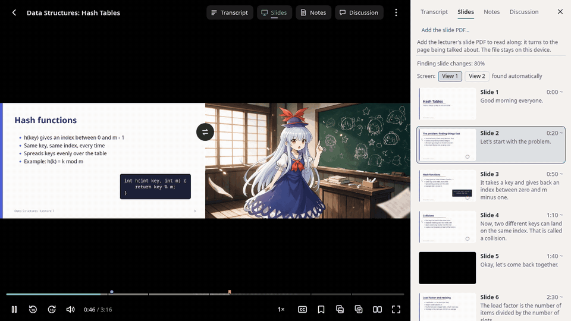
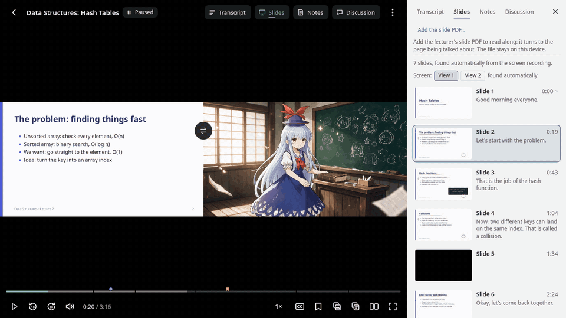
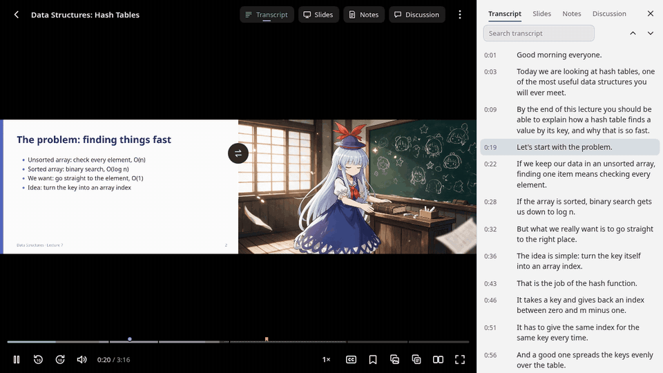

[English](README.md) | **简体中文**

# Echo360 轻量播放器（Lite Player for Echo360）

[](https://github.com/zhenban/lite-player-for-echo360/actions/workflows/ci.yml)
[](https://github.com/zhenban/lite-player-for-echo360/releases/latest)
[](https://chromewebstore.google.com/detail/lite-player-for-echo360/bbcmnjnijjfpnngkkgoahjljibfackbh)
[](LICENSE)

**更快、更流畅的 Echo360 课程回放播放器，还有帮你学习的工具：**两个画面并排、幻灯片章节、自动翻页的幻灯片 PDF、可搜索的转录。旧电脑也能流畅播放，边看边记笔记时电脑照样顺手。（原理：Echo360 原播放器播放时一直占满一个 CPU 核心；轻量播放器让浏览器自己用硬件解码播放同样的视频流，开销接近直接播放一个视频文件。）



笔记、书签、讨论区和观看进度仍是 Echo360 自己的数据；原播放器随时一键切回。

## 安装

同一个播放器有两种安装方式，功能和设置完全相同。二选一，不要同时装。

### Chrome 或 Edge 扩展（最简单）

1. 打开 **[Chrome 应用商店里的 Lite Player for Echo360](https://chromewebstore.google.com/detail/lite-player-for-echo360/bbcmnjnijjfpnngkkgoahjljibfackbh)**，点 **添加至 Chrome**。用 Edge 时，如果提示，先点 **允许来自其他应用商店的扩展**。
2. 打开任意一节 Echo360 课程回放。

扩展会自动更新。

<details>
<summary>不用应用商店（手动安装）</summary>

从[最新版本](https://github.com/zhenban/lite-player-for-echo360/releases/latest)下载 `lite-player-for-echo360-extension-….zip` 并解压。打开 `chrome://extensions`（Edge：`edge://extensions`），开启 **开发者模式**，点 **加载已解压的扩展程序**，选择解压出的文件夹。这样装的扩展不会自动更新：有新版本时重新加载新的 zip。改用商店版之前，先移除这一份。
</details>

### 用户脚本（所有支持的浏览器）

1. **安装用户脚本管理器：**[Tampermonkey](https://www.tampermonkey.net/) 或 [Violentmonkey](https://violentmonkey.github.io/)。Chrome / Edge：在 `chrome://extensions` 打开脚本管理器的“详细信息”，开启 **“允许用户脚本”**（旧版本是开启“开发者模式”）。
2. **安装轻量播放器：**打开 **[lite-player-for-echo360.user.js](https://github.com/zhenban/lite-player-for-echo360/releases/latest/download/lite-player-for-echo360.user.js)**，脚本管理器提示时点 **安装**。
3. **打开任意一节 Echo360 课程回放。**新播放器会出现在原播放器的位置。

脚本管理器会自动更新；每个[版本](https://github.com/zhenban/lite-player-for-echo360/releases/latest)都写明了改了什么。

### 在哪里能用

- **网站：**在 `echo360.net.au` 上测试过。Echo360 美国（`echo360.org`）、英国和欧洲（`echo360.org.uk`）、加拿大（`echo360.ca`）的网站是同一个应用，播放器在那里也会运行，但还没有实际试过：如果有问题，请[提交 issue](https://github.com/zhenban/lite-player-for-echo360/issues)。学习平台把回放嵌在自己页面里时也能用，只是没有悬浮窗；如果那个页面不允许全屏，也不能全屏。
- **浏览器：**电脑上的 Chrome、Edge、Firefox；安卓上的 Firefox（装 Tampermonkey 或 Violentmonkey）。
- **尽量支持：**iPad 和 iPhone 上 iOS 15.4 及以上的 Safari，装 Stay 或 Userscripts 等脚本管理器。iPhone 上的全屏用系统播放器显示主画面；音频处理需要 iOS 17.1。
- **其他情况：**认不出的页面、太旧的浏览器，保留原播放器（并提示原因）。第一次打开较慢时，加载画面上可以立即改用原播放器，20 秒后会自动打开原播放器。

## 功能

### 幻灯片、PDF 和转录

- **幻灯片章节。**自动找出每次换页。“幻灯片”标签页列出每一页的图片和老师讲的内容；进度条上标出章节，悬停显示预览；`Shift+←` / `Shift+→` 切换上一页 / 下一页。
- **幻灯片 PDF 跟着翻页。**把老师的 PDF 拖到播放器上，它会识别屏幕上的文字，翻到正在讲的那一页。你随时可以自己往前翻，点一下就回到老师讲到的地方。文件不会离开你的电脑。

  

- **字幕和转录。**字幕四档字号。转录跟着讲课滚动；点一句话跳到那里，或者搜索整节课，在进度条上看到所有结果。

  

### 观看

- **两路画面同时看。**屏幕和摄像机并排（拖动分割线）、画中画（拖动、缩放、吸附四角）或只看一路；按 `S` 交换。两路保持同步。屏幕长时间没有画面时，自动只显示摄像机（可撤销，可关闭）。
- **幻灯片清晰。**按网络允许的最高画质播放，两路画面分别选择。
- **跳过空白。**课间休息、小组讨论、黑屏都标在进度条上，有“跳过”按钮，也可以自动跳过。结尾长时间空白时会提示课已经结束。
- **声音更清楚**（默认关闭）：老师离麦克风忽远忽近时均衡音量、增强人声，或改成单声道。
- **放大和平移**屏幕、摄像机或 PDF（滚轮或双指；双击复原）。**A-B 循环**反复看一段推导。把整个播放器弹成置顶的**悬浮窗**，一边看一边做题。

### 笔记和 Echo360

- **笔记、书签、“没听懂”标记和讨论区**，照常保存到 Echo360，并标在进度条上。按 `B` 一键加书签。
- **私人标签**，例如“考试”“作业”，可以筛选，进度条上按颜色标出。标签只存在你的设备上。
- **导出**笔记、书签和标签为 Markdown，带回到那一刻的链接；有幻灯片 PDF 时附带页面图片。可以导出一节课或整门课。只存在浏览器里的数据都可以备份和恢复。
- **看过哪些一目了然：**进度条上标出看过的部分；课程页上每节课旁边有一个小进度条（本设备看过的部分，以及 Echo360 记录的上次停下位置）。换设备也能接着看。
- **不被打断：**视频访问权限在后台续期，长时间观看不用刷新。
- **如实上报观看记录：**和原播放器一样向 Echo360 报告观看进度，数据来自你实际播放的部分。
- **随时可以切回：**“原播放器”按钮在当前位置切回 Echo360 播放器。出现任何问题时自动改用原播放器，并为它启用降低 CPU 占用的补丁。
- 中文或英文界面，跟随浏览器（也可以在菜单里选）。

### 需要知道的

- 直播，以及要先同意版权声明的录像，会使用原播放器。投票、Echo360 自带的幻灯片、附件和口述影像也在原播放器里（一键切过去）。
- 看到一半登录过期时，会提示刷新，刷新后从同一位置继续。
- 幻灯片章节来自屏幕画面的变化；用摄像机拍的白板可能只找到几页。如果用错了画面，可以在“幻灯片”标签页里选对的那一路。
- PDF 跟读能识别英文、中文、日文、韩文、俄文、希腊文、阿拉伯文、希伯来文、泰文、印地文（其他语言按英文处理）。英文以外的语言首次需要下载 0.6–2.7 MB 的识别数据。
- 没有转录时，静音从音频里判断，所以离麦克风很远、很轻的说话可能被标成静音。只有你点了跳过或开启自动跳过才会跳过。

## 快捷键

| 按键 | 作用 | 按键 | 作用 |
|---|---|---|---|
| `Space` / `K` | 播放 / 暂停 | `S` | 交换画面 |
| `←` / `→` | 后退 / 前进 5 秒 | `C` / `T` | 字幕 / 转录 |
| `J` / `L` | 后退 / 前进 10 秒 | `B` | 书签 |
| `Shift+←` / `Shift+→` | 上一页 / 下一页幻灯片 | `U` | “没听懂” |
| `↑` / `↓` · `M` | 音量 · 静音 | `G` | 给这里的笔记或书签加标签 |
| `[` / `]` | 减速 / 加速 | `I` / `O` / `X` | 循环起点 / 终点 / 清除 |
| `F` | 全屏 | `+` / `-` / `0` | 放大 / 缩小 / 完整画面 |
| `W` | 悬浮窗 | `P` | 复制当前画面 |
| `E` | 导出和备份 | `A` | 复制最近 60 秒的转录 |
| `?` | 全部快捷键 | `Esc` | 关闭菜单 |

## 隐私

- **留在你这里：**设置、标签、观看进度、分析结果、幻灯片 PDF 和备份都存在你的浏览器里；笔记、书签和讨论区仍在 Echo360 上，和原来一样。导出和备份从不包含视频或视频地址，也没有下载功能。
- **不替你发布任何东西：**只有你点击时才会写入 Echo360；老师或同学能看到的内容，发送前都会标明。
- **库经过校验：**hls.js、pdf.js 和 Tesseract.js 只有与固定的 SHA-256 一致时才会运行（扩展自带这些库；用户脚本从 jsDelivr 加载）。幻灯片文字在你的浏览器里识别。

### 匿名使用数据

除了 Echo360，播放器只向一个地方发送数据：匿名使用数据，用来发现和修复只在别人电脑上出现的问题。Greasy Fork 对此的标注是 `@antifeature tracking`。

- **关闭：****设置（⋮）>“使用数据”**，立即停止发送。同一页有“查看我的数据”“删除我的全部数据”和“重置我的 ID”。
- **发送什么：**电脑和浏览器信息（每天最多一次）；每次观看一份取整后的汇总（启动时间、流畅度、响应速度、用到了哪些功能、幻灯片和静音分析的效果、去掉个人信息的错误）；切回原播放器的次数和原因；在 Echo360 的哪个地区网站上，以及是否嵌在别的网站里。只有汇总，没有逐条的数值序列。
- **从不发送：**你的姓名、账号、学号或邮箱；你看了哪些课程或录像、它们的标题或地址；你写的任何内容；字幕或幻灯片内容；你的 IP 地址。
- **发到哪里：**本项目自己运行的 Cloudflare Worker 和 D1 数据库（代码在 [`telemetry-worker/`](telemetry-worker/)）。它只通过一个随机密钥的哈希认识你，密钥保存在脚本管理器或扩展里，页面读不到。只有维护者能看，在只显示总数的私人面板上。每个字段都列在 [PRIVACY.md](PRIVACY.md)（英文）。

唯一公开的数字是每天的活跃用户数：

<picture>
  <source media="(prefers-color-scheme: dark)" srcset="https://raw.githubusercontent.com/zhenban/lite-player-for-echo360/stats/usage-dark.svg">
  
</picture>

## 开发

```sh
npm install                # 开发工具
npm run build              # src/*.js -> dist/lite-player-for-echo360.user.js（可读，未压缩）
npm run build-extension    # Chrome 扩展 -> dist-extension/ 和 dist-extension.zip
npm test                   # 单元测试和整页测试
npm run ci                 # lint、类型检查、测试、dist/ 与源码一致（GitHub Actions 运行的就是它）
```

只改 `src/`；`dist/` 由构建生成。代码结构见 [ARCHITECTURE.md](ARCHITECTURE.md)，报告安全问题见 [SECURITY.md](SECURITY.md)。使用数据的服务端和私人面板在 [`telemetry-worker/`](telemetry-worker/) 和 [`telemetry-admin/`](telemetry-admin/)。

运行时用到的库，固定版本（不在仓库里）：[hls.js](https://github.com/video-dev/hls.js) 1.7.3、[pdf.js](https://github.com/mozilla/pdf.js) 6.4.299、[Tesseract.js](https://github.com/naptha/tesseract.js) 和 tesseract.js-core 7.0.0（Apache-2.0），以及 Tesseract 语言数据 1.0.0（MIT）。

## 许可

Copyright (C) 2026 zhenban。自由软件，采用 [GNU GPL v3 或更高版本](LICENSE)。v0.14.0 及以前的版本采用 MIT 许可，仍保持不变。

轻量播放器是一个独立项目。Echo360 是其所有者的商标，这里提到它只是为了说明播放器适用于哪个网站。

图片里的演示课程是为本项目制作的。其中摄像机画面用 AI 视频工具生成，为《东方Project》非官方二次创作，原作：上海爱丽丝幻乐团 / ZUN。
